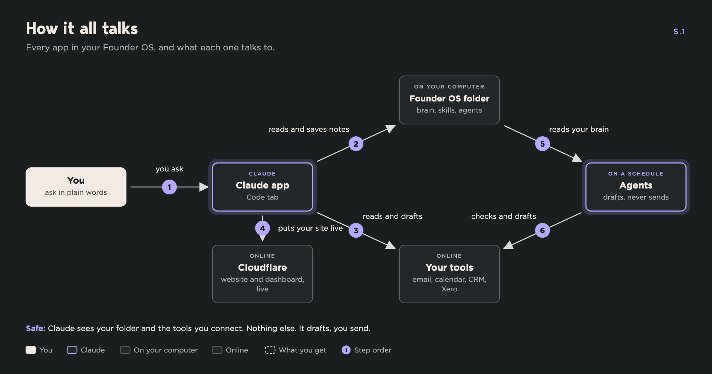

# Founder OS

Your AI, set up properly. One level at a time.

This folder is your Founder OS. It holds your AI brain, your skills, your dashboard and your agents. You own all of it. Claude reads it every time you work.

## How it flows
What talks to what in each step. Cream is you, purple is Claude, the numbers are the order.




## Start here

**Get your copy (once):**
1. Driven Young adds your GitHub username to the Founder OS. Open the link you're sent and press **Use this template**, then **Create a new repository**. Name it `Founder OS`, choose **Private**, and press **Create**.
2. On your new copy press the green **Code** button, then **Open with GitHub Desktop**. GitHub Desktop (free, desktop.github.com) asks where to save it: keep **Documents** and press **Clone**. You now have a `Founder OS` folder on your computer, and your private copy on GitHub keeps a backup of every change.

**Then, every time:**
1. Open the **Claude** desktop app and go to the **Code** tab (or open Terminal and type `claude`).
2. Pick your `Founder OS` folder.
3. Type: **start my Founder OS**

Claude takes it from there, one step at a time.

## The six levels

| Level | Name | What you get |
| --- | --- | --- |
| 0 | Upgrade | Claude plus the skills that make it sharp |
| 1 | Brain | Your AI brain. Claude knows your business |
| 2 | Connect | Inbox, calendar, CRM and money in one conversation |
| 3 | Build | Your dashboard, pages and site, live and backed up |
| 4 | Streamline | Your messy, repeated jobs turned into a system |
| 5 | Delegate | Agents doing the weekly jobs, drafts only |

Every level has the same four steps: **Why**, **Set up**, **Make your own**, **Check**. The guides are in `levels/`.

## What's in here

```
Founder OS/
  README.md          this page
  CLAUDE.md          how Claude works in this folder
  Progress.md        your tick list, level by level
  levels/            the guide for each level
  brain/             your AI brain (open it in Obsidian)
  library/           Before you start, Quick wins, Security, Brand Studio
  dashboard/         your founder dashboard (Level 3)
  site/              your website starter + templates (Level 3)
  agents/            your agents (Level 5)
  .claude/skills/    the skills Claude uses to guide you
```

## Things you can say

- **start my Founder OS** or **what's next**: picks up where you left off
- **install my Claude Upgrade**: Level 0
- **build my AI brain** / **continue my brain** / **brain check-up**: Level 1
- **give me a quick win**: a small useful job, done now
- **build my website** / **rebuild my website from <address>**: Level 3
- **build my dashboard** / **add a page to my dashboard**: Level 3
- **help me with a key**: store an API key safely, without it touching the chat
- **security check**: your plain-English security check and fix list
- **brand studio**: your design system, a brand refresh, and real slides, posts, posters and flyers
- **pull the latest Founder OS**: brings in new templates and agents

## Is this safe?

Yes. Claude only sees this folder unless you choose otherwise, asks before it changes anything, never sees your passwords, and only drafts: it never sends, pays or posts. Every level explains exactly what it can and can't do.

## Licence

The Founder OS is licensed to your business only. Use it and change it however you like for your own business. Don't sell it, share it or use it to set up anyone else's business. Everything you make with it is yours. Full terms: `LICENSE.md`.

## Keep it private

Your copy on GitHub must be **private**. Your brain holds your prices, customers and numbers. Never store passwords, bank details or card numbers in these files.

Driven Young Founder OS. Beta, November 2026.

---
Driven Young Founder OS · licensed to one business · see LICENSE.md
