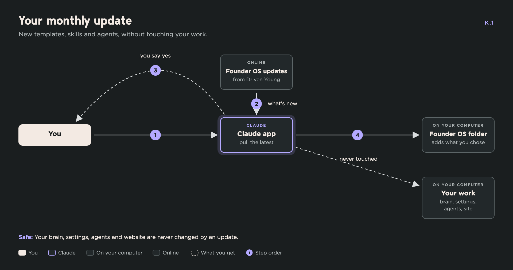

# Founder OS

Your AI, set up properly. One level at a time.

This folder is your AI brain, skills, dashboard and agents. You own it.

## How it flows
Cream is you. Purple is Claude.




## Start here

**Get your copy (once):**
1. In the **Claude** desktop app, click **Code**.
2. Choose **Documents**. (Windows: if Documents is in OneDrive, choose your user folder.)
3. Paste: *Install my Founder OS from https://github.com/byron-rgb/founder-os and follow its INSTALL.md*. It lands in `Documents/Founder OS`.
4. GitHub backup comes in Level 3 (say **save a copy**).


**Then, every time:**
1. In the **Claude** app, click **Code** (or type `claude` in Terminal).
2. Pick your `Founder OS` folder.
3. Type: **start my Founder OS**

## The six levels

| Level | Name | What you get |
| --- | --- | --- |
| 0 | Upgrade | Claude plus key skills |
| 1 | Brain | Claude knows your business |
| 2 | Connect | Inbox, calendar, CRM and money in one chat |
| 3 | Build | Dashboard, pages and site, live and backed up |
| 4 | Streamline | Repeated jobs become a system |
| 5 | Delegate | Agents do weekly jobs, drafts only |

Each level: **Why**, **Set up**, **Make your own**, **Check**. Guides are in `levels/`.

## What's in here

```
Founder OS/
  README.md          this page
  CLAUDE.md          how Claude works in this folder
  Progress.md        your tick list, level by level
  levels/            the guide for each level
  brain/             your AI brain (open it in Obsidian)
  library/           Before you start, Quick wins, Security, Brand Studio
  dashboard/         your founder dashboard (Level 3)
  site/              your website starter + templates (Level 3)
  agents/            your agents (Level 5)
  .claude/skills/    the skills Claude uses to guide you
```

## Things you can say

- **start my Founder OS** or **what's next**: carry on
- **install my Claude Upgrade**: Level 0
- **build my AI brain** / **continue my brain** / **brain check-up**: Level 1
- **give me a quick win**: a small job, now
- **build my website** / **rebuild my website from <address>**: Level 3
- **build my dashboard** / **add a page to my dashboard**: Level 3
- **help me with a key**: store a key safely
- **security check**: check and fix list
- **brand studio**: design system, refresh, on-brand content
- **pull the latest Founder OS**: new templates and agents

## Is this safe?

Yes. Claude sees only this folder unless you choose otherwise. It asks before changing anything, never sees your passwords, and only drafts. It never sends, pays or posts.

## Licence

The Founder OS is licensed to your business only. Use it and change it however you like for your own business. Don't sell it, share it or use it to set up anyone else's business. Everything you make with it is yours. Full terms: `LICENSE.md`.

## Keep it private

Your GitHub copy must be **private**. Never store passwords, bank details or card numbers in these files.

Driven Young Founder OS. Beta, November 2026.

---
Driven Young Founder OS · licensed to one business · see LICENSE.md
