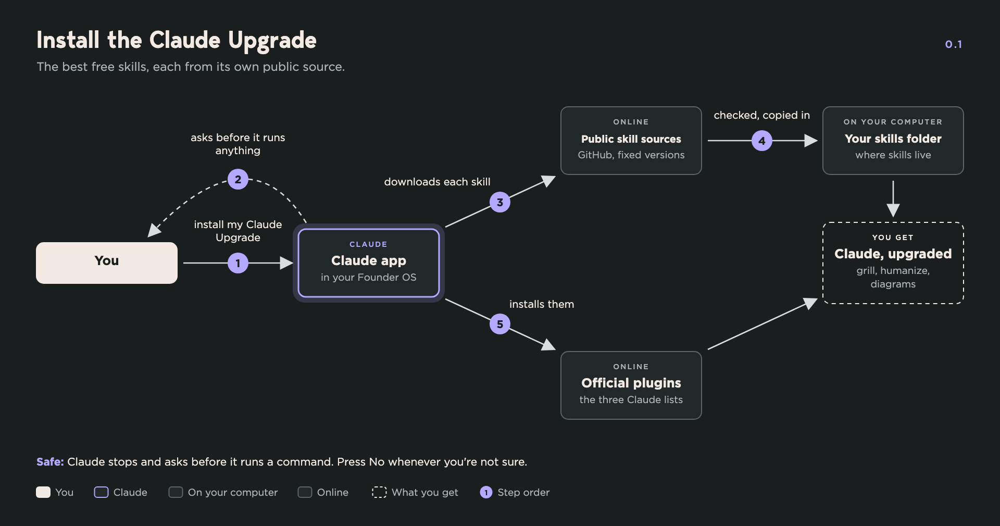
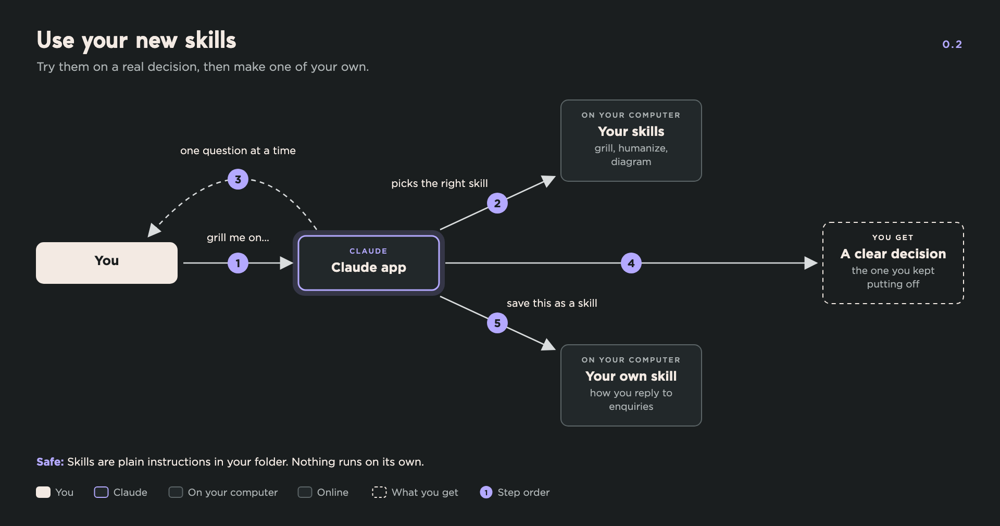

# Level 0 · Upgrade

Claude, plus the skills that make it sharp.

## How it flows
Cream is you. Purple is Claude. Numbers show the order.





## 1. Why
Skills make Claude plan, write and design better. Every level uses them. About 20 minutes.

**Is this safe?** Yes. Claude only works in the folder you give it. It asks before it changes anything. Every skill is free, public and checked by us.

## 2. Set up

### Claude, two ways in
1. Get the **Claude desktop app** at claude.ai/download.
2. Sign in on the **Pro** plan or higher.
3. Optional: add Claude to your Terminal.
   - Press Cmd + Space, type **Terminal**, press Enter.
   - Paste this and press Enter:
     ```
     curl -fsSL https://claude.ai/install.sh | bash
     ```
   - Close Terminal. Open a new one.
   - Type `claude` and press Enter.
   - Sign in with the same Claude account.
   - **On Windows:** first install **Git for Windows** (free, git-scm.com, keep the defaults). Open **PowerShell** and paste `irm https://claude.ai/install.ps1 | iex` instead.

### Pick Claude's folder
Claude only sees the folder you start it in.
- **Start here:** your `Founder OS` folder. In the app's **Code** tab, pick `Founder OS`. In Terminal: `cd "Founder OS"` then `claude`.
- **Later, if you like:** your whole user folder. Claude still asks before every change.

You can switch any time.

### Install the Upgrade
1. In your Founder OS folder, say **install my Claude Upgrade**.
2. Claude installs each skill and says what it does.

### Add the plugins
1. In the Claude app, click **Plugins** on the left.
2. Add **frontend design**.
3. Add **security guidance**.
4. Add **cloudflare** (the one that says Connector & skills · cloudflare/skills).

### The permission boxes
Claude asks before it runs or changes anything. You pick **Yes**, **Yes, and don't ask again**, or **No**. Not sure? Press **No**.

## 3. Make your own
Say **grill me on the one decision I keep putting off.**

## 4. Check
- [ ] Claude app on Pro, signed in
- [ ] Claude in Terminal (optional)
- [ ] Claude's folder chosen
- [ ] Upgrade pack installed
- [ ] Official plugins installed
- [ ] Ran one grill

Next: Level 1 · Brain.

---
Driven Young Founder OS · licensed to one business · see LICENSE.md
