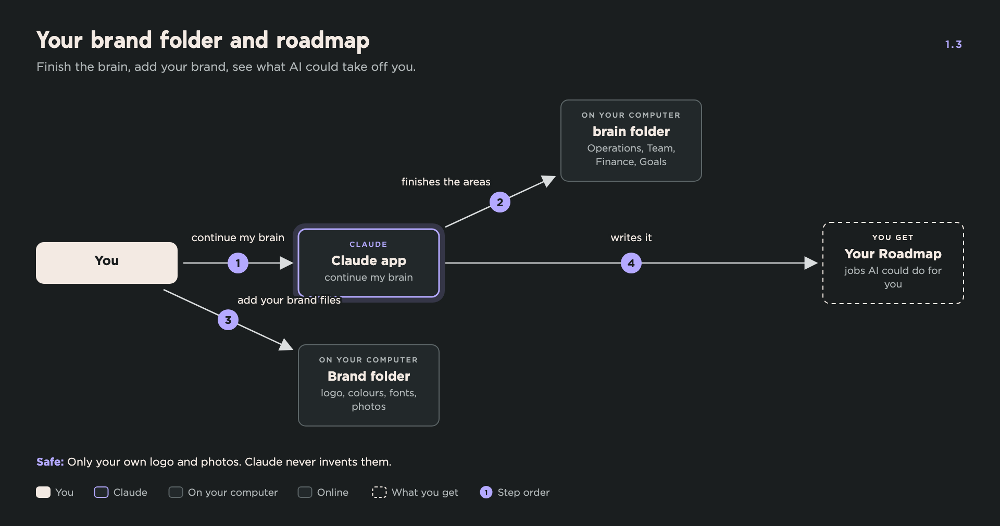
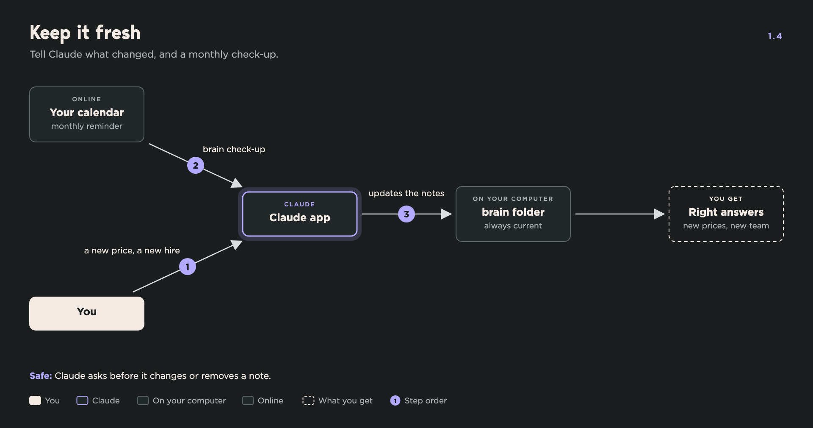

# Level 1 · Brain

Your AI brain. Claude knows your business.

## How it flows
What talks to what in each step. Cream is you, purple is Claude, the numbers are the order.

## 1. Why
Generic answers come from AI that doesn't know you. Your brain is a folder of plain notes about you and the business: offers, prices, customers, voice, how things run, your goals. Claude reads it every time. In Obsidian you can see it as a graph and watch it grow. It also holds your **Brand** folder: logo, colours, fonts and style in one design file, so everything Claude makes looks like you.

**Is this safe?** Your brain is plain notes on your own computer. Nothing is uploaded anywhere unless you choose to back it up (Level 3, to your private GitHub). Never put passwords, bank or card numbers in it; Claude leaves them out if you paste one.

## 2. Set up
1. Install **Obsidian** (free, obsidian.md).
2. In Obsidian: **Open folder as vault** and choose `Founder OS/brain`.
3. Before you start, drop your price list, any brochures or proposals into `brain/Drop files here`.
4. In Claude, say: **build my AI brain**. Claude reads your website and files, then interviews you across seven areas: You, Sales, Marketing, Operations, Team, Finance, Goals. Type or talk. About 2 hours, and you can stop any time ("continue my brain" picks it up). Short on time? Say **quick brain** for a 20-minute start and fill in the rest later.
5. **Your brand.** Claude moves your brand in: your logo files, Canva brand kit, designer files and website colours go into `brain/3 Marketing/Brand/`. No brand yet? Claude sets up a simple starter brand with you. Open `Brand Board.html` to see it on one page.
6. In Obsidian, open **Graph view** to see it connect.

## 3. Make your own
Big one: say **brand studio** to turn your brand into a design system and make real slides, posts and a poster.
Or pick one quick win (say **give me a quick win**):
- Your email signature, built from your brain
- Your price list as a clean PDF

## 4. Check
- [ ] Obsidian open on the brain, graph shows
- [ ] All seven areas have notes
- [ ] Brand folder done, Brand Board looks right
- [ ] Ask "what do we charge for <service>?" and Claude gets it right
- [ ] Monthly **brain check-up** in your calendar (add it yourself, or Claude does it after Level 2)

Next: Level 2 · Connect.

---
Driven Young Founder OS · licensed to one business · see LICENSE.md
