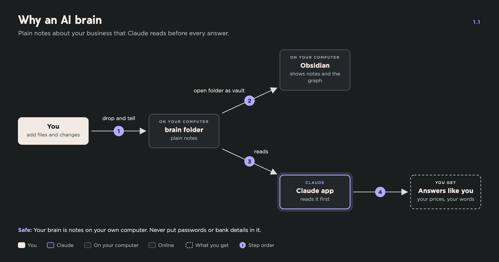
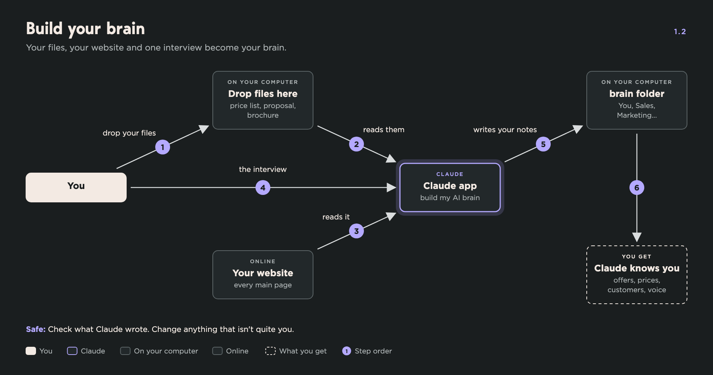

# Level 1 · Brain

Your AI brain. Claude knows your business.

## How it flows
Cream is you. Purple is Claude. Numbers show the order.

## 1. Why
Your brain is notes about you and your business. Claude reads it every time. It also holds your **Brand** folder: logo, colours, fonts and style.

**Is this safe?** Your brain stays on your computer. Nothing is uploaded unless you back it up (Level 3, to your private GitHub). Never put passwords, bank or card numbers in it. Claude leaves them out if you paste one.

## 2. Set up
1. Say **open my brain in Obsidian**. Claude installs Obsidian (free) and opens your brain.
2. Put your price list, brochures and proposals in `brain/Drop files here`.
3. Say **build my AI brain**. Claude reads your website and files, then asks about You, Sales, Marketing, Operations, Team, Finance and Goals. Type or talk. About 2 hours.
4. Need a break? Stop any time. Say **continue my brain** later.
5. Short on time? Say **quick brain** for a 20-minute start.
6. Claude moves your logo, Canva brand kit, designer files and website colours into `brain/3 Marketing/Brand/`. No brand yet? Claude makes a simple one with you.
7. Open `Brand Board.html` to see your brand on one page.
8. In Obsidian, open **Graph view**.

## 3. Make your own
Big one: say **brand studio**. Claude turns your brand into a design system and makes slides, posts and a poster.
Or say **give me a quick win**:
- Your email signature, built from your brain
- Your price list as a clean PDF

## 4. Check
- [ ] Obsidian open on the brain, graph shows
- [ ] All seven areas have notes
- [ ] Brand folder done, Brand Board looks right
- [ ] Ask "what do we charge for <service>?" and Claude gets it right
- [ ] Monthly **brain check-up** in your calendar (add it yourself, or Claude does it after Level 2)

Next: Level 2 · Connect.

---
Driven Young Founder OS · licensed to one business · see LICENSE.md
