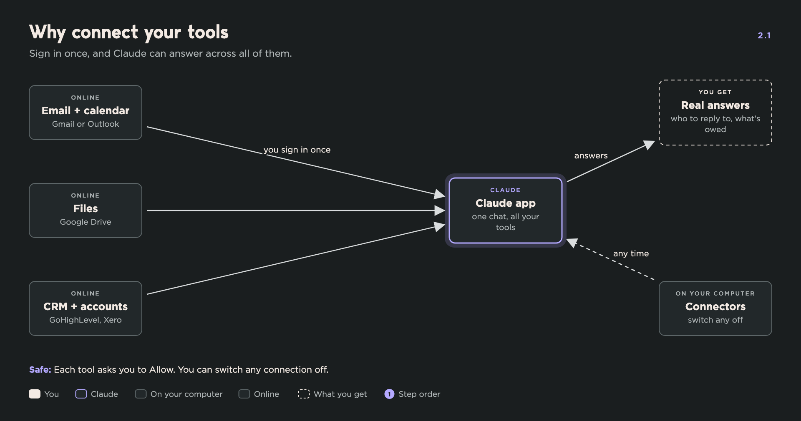
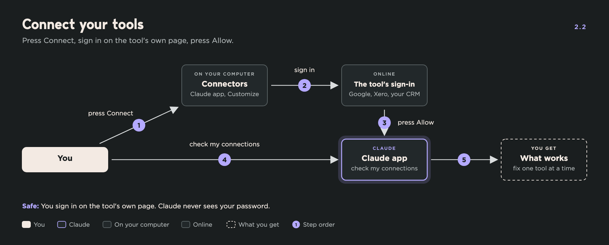
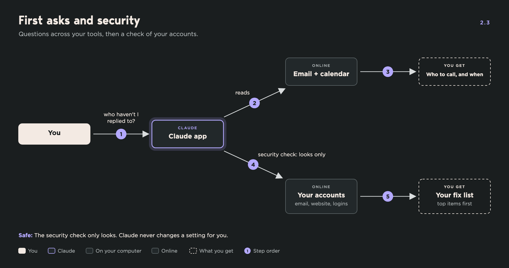

# Level 2 · Connect

Inbox, calendar, files, CRM and money in one conversation.

## How it flows
Cream is you. Purple is Claude. Numbers show the order.

## 1. Why
Connect your apps. Then Claude can tell you who needs a reply, what's overdue and where the money is.

**Is this safe?** You sign in on each tool's own page, so Claude never sees your passwords. Each connection only does what you allow. Switch any off in **Customize**, **Connectors**.

## 2. Set up
You do this part. Only you can sign in.

### Built-in connectors
1. In the Claude app, open **Customize**, then **Connectors**.
2. Find a tool (Gmail, Google Calendar, Google Drive and more).
3. Press **Connect**. Sign in on the tool's page. Press **Allow**.
   Or say **connect Xero** (or any tool) and press the button Claude shows.
4. Say **check my connections**. Claude tests each tool (look only, no changes), helps fix what fails, and saves the list in `brain/4 Operations/Connections.md`.

### Tools without a built-in connector
1. Ask **is there a connector for <tool>?** Claude finds the official link.
2. In **Customize**, **Connectors**, press **+**, then **Add custom connector**.
3. Paste the link, name it, press **Add**.
4. Sign in on the tool's page.
5. Only use links from the tool's own website, or one Claude found there. Never paste a link someone sent you.
6. No connector? Ask Claude. Usually you drop in an exported file, or use a bridge like Zapier.

### Our picks, if you're choosing
| Job | Our pick | Also fine |
| --- | --- | --- |
| Email + calendar | Gmail, Google Calendar | Outlook |
| Files | Google Drive | iCloud, Dropbox |
| CRM, forms, follow-ups | GoHighLevel | HubSpot, Attio |
| Accounts | Xero | MYOB, QuickBooks |
| Tasks + notes | Roma | Notion |
| Selling online | Shopify | |

## 3. Make your own
Ask **who haven't I replied to this week, and when am I free to call them?**
Quick wins: quote from a voice note, meeting notes to follow-up email, review replies, plan my week.

Then run your first **security check** (see `library/Security.md`).

## 4. Check
- [ ] Email, calendar and files connected
- [ ] One tool added with a custom connector, if you need one
- [ ] CRM and accounting connected, if you use them
- [ ] A morning brief that's actually right
- [ ] First security check done

Next: Level 3 · Build.

---
Driven Young Founder OS · licensed to one business · see LICENSE.md
