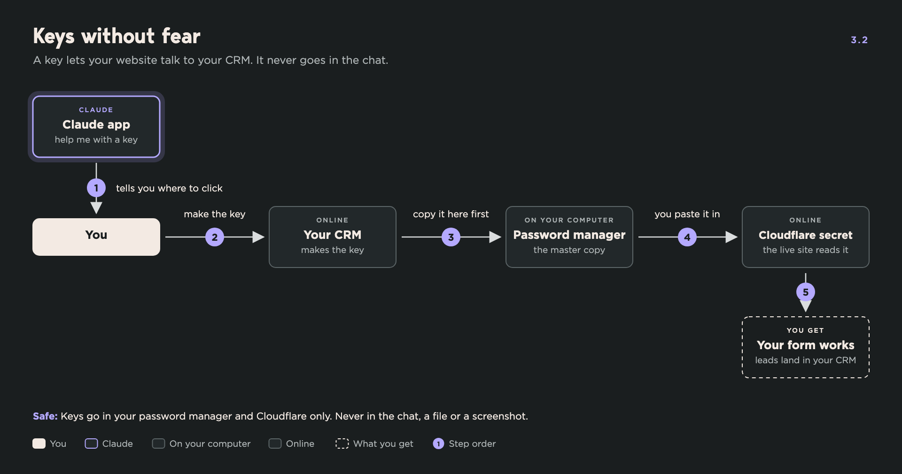
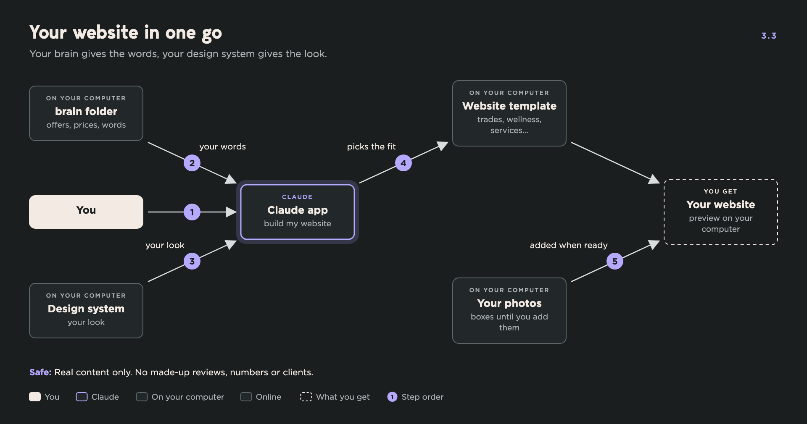
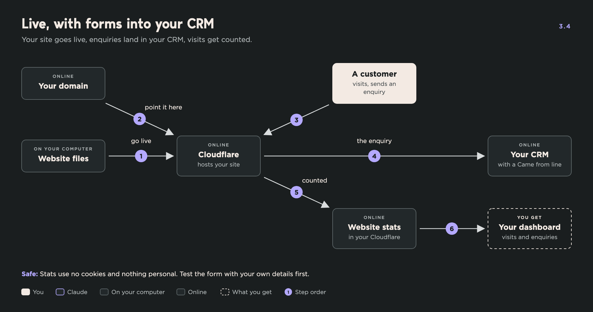
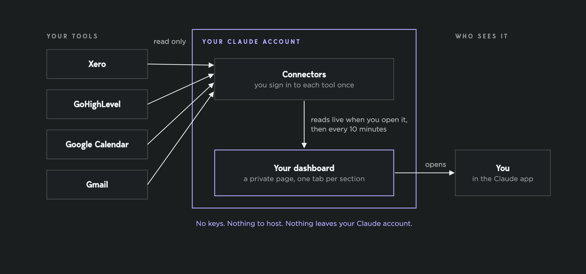
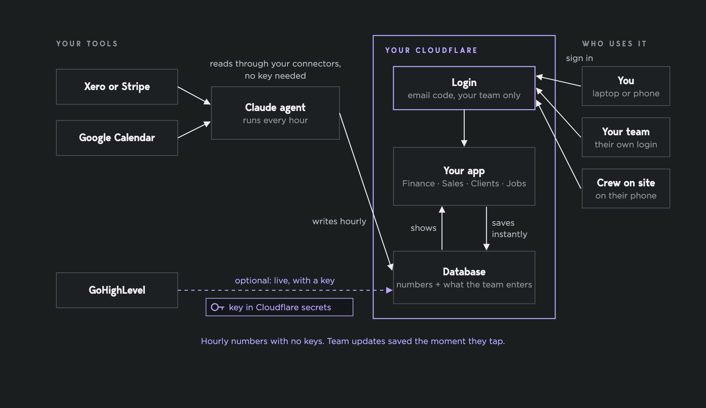
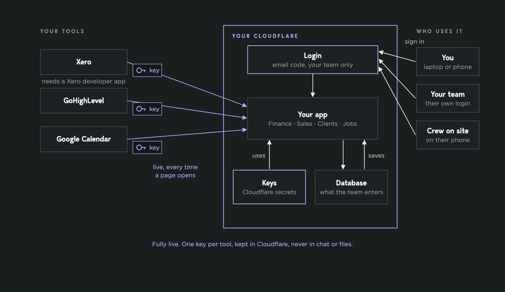

# Level 3 · Build

Your dashboard, pages and site. Live and backed up.

## How it flows
Cream = you. Purple = Claude. Numbers = order.

## 1. Why
You own every file. Change anything by asking.

**Is this safe?**
- Your GitHub copy is private. Only you see it.
- Every change is saved. Anything can be undone.
- Nothing goes live until you say so.
- Your form key goes in Cloudflare's encrypted secrets, typed by you. Never in the chat or your files.

## 2. Set up
**Back up (GitHub)**
1. Make a free GitHub account at github.com.
2. Install **GitHub Desktop** (free, desktop.github.com).
3. Sign in to it with your GitHub account.
4. Say **save a copy**.
5. First time only: Claude opens GitHub Desktop. Click **Publish repository**. Leave **Keep this code private** ticked. Click **Publish repository**.
6. After that, say **save a copy** to back up your latest changes.

Copy already made from the template? Just save.

**Go live (Cloudflare)**
1. Make a free Cloudflare account. It puts your pages live.

**Your dashboard**
1. Say **build my dashboard**.
2. Tell Claude what to track.
3. Claude builds a private dashboard in your Claude account: one page per section (Finance, Sales, Marketing and the rest), live from your Level 2 tools. It only reads.

**Your website and landing pages** (`site/`)
1. Say **build my website**.
2. Claude builds the whole site in one go, from your brain and design system.

Claude uses the Founder OS site starter: plain Astro, optional templates in `site/templates/` (landscaping, trades, health and wellness, beauty, services), and a quote form that sends leads to GoHighLevel or any CRM.

Want more GoHighLevel page designs? Damn Good Funnels is free for your own business. Download it yourself (see `site/README.md`).

**Keys for your forms**
1. Say **help me with a key** (your forms need a GoHighLevel key).
2. Paste it in yourself. Never paste a key into the chat (see `library/Security.md`).

## Your dashboard: two ways
**In Claude (included).** A private page in your Claude account, reading your Level 2 connections. Live, no keys, nothing to host. For you.

**A live app for your team (add-on).** Your own app on your own web address. Your team and crew log in and update it (job stages, who's on site). Numbers come in two ways:

- **Hourly, no keys:** a Claude agent copies in Xero, Stripe and calendar numbers every hour.

- **Fully live, with keys:** one key per tool, kept in Cloudflare secrets. Xero also needs a small developer app.

It's on the web, so login and keys need care. Driven Young sets it up ($1,000 setup), or do it with Claude yourself. Most start in Claude and add the app when the team needs it.

## Your website
- **Rebuild it here (most people).** Say **rebuild my website from <your address>**. Claude keeps what works, rebuilds it on your brand and links it to your Founder OS. No more web developer bills.
- **Google search brings lots of work?** Talk to an SEO expert before you move.
- **Sell on Shopify?** Stay there. Use the Founder OS around it.

## 3. Make your own
Say **build a landing page for my main offer.**
Quick wins: job ad page, how-to from a video, client welcome pack.

## 4. Check
- [ ] GitHub Desktop installed and signed in
- [ ] Latest changes saved to your private GitHub copy
- [ ] Dashboard live, at least one module on real data
- [ ] Website built or rebuilt from your brain and design system
- [ ] One landing page live with a working form
- [ ] Form key stored safely (password manager + Cloudflare secret)

Next: Level 4 · Streamline.

---
Driven Young Founder OS · licensed to one business · see LICENSE.md
