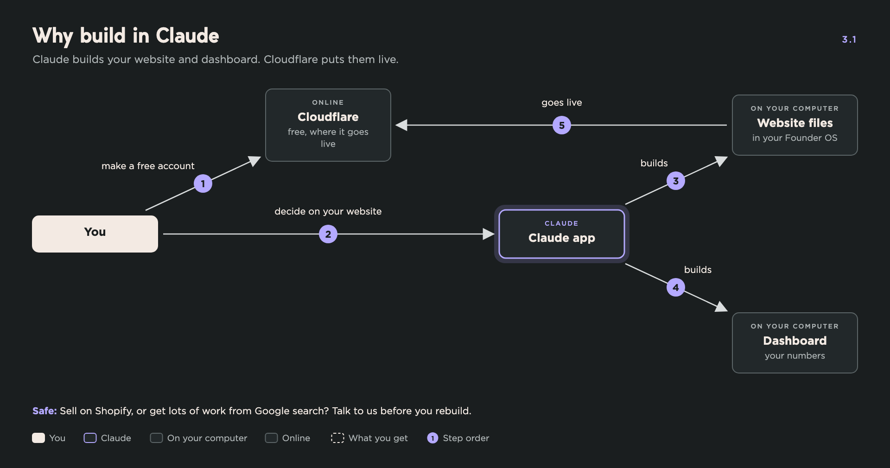
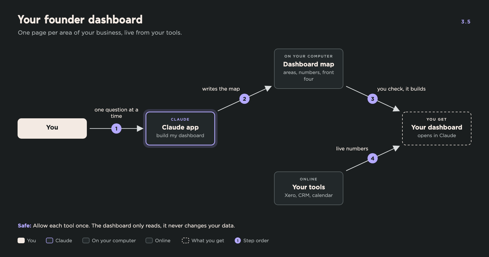

# Level 3 · Build

Your dashboard, pages and site. Live and backed up.

## How it flows
What talks to what in each step. Cream is you, purple is Claude, the numbers are the order.

## 1. Why
This is where AI stops being a chat and becomes part of how you run the business. You own every file and can change anything by asking.

**Is this safe?** Your GitHub copy is set to private, so only you can see it. Every change is saved, so anything can be undone. Nothing goes live until you say so. The one key your forms need goes into Cloudflare's encrypted secrets, typed by you, never into the chat or your files.

## 2. Set up
1. **GitHub**: your Founder OS is already your own **private** copy on GitHub (you made it before Level 0). Say **save a copy** whenever you want your latest changes backed up; every change is kept and can be undone.
2. **Cloudflare**: make a free account. It puts your website and pages live.
3. **Your dashboard**: say **build my dashboard**. Claude asks what you want to track, maps it with you, then builds a private dashboard in your Claude account: one page per section (Finance, Sales, Marketing and the rest), live from the tools you connected in Level 2. It only reads.
4. **Your website and landing pages** (`site/`): Claude already knows your business (your brain) and your look (your design system), so say **build my website** and it builds the whole site in one go. It uses the Founder OS site starter: plain Astro, ready-made templates for common businesses (landscaping, trades, health and wellness, beauty, services), your design system for the look, and a quote form that sends leads to GoHighLevel or any other CRM. Using GoHighLevel and want even more page designs? Damn Good Funnels is free for your own business; download it yourself (see `site/README.md`).
5. **Keys for your forms**: the forms need a GoHighLevel key. Say **help me with a key**. You paste it in yourself, it never goes in the chat (see `library/Security.md`).

## Your dashboard: two ways
**In Claude (included).** A private page in your Claude account, reading your tools through the connections from Level 2. Live every time you open it, no keys, nothing to host. For you.

**A live app for your team (add-on).** Your own app on your own web address, with a login for your team and crew, saving what they update (job stages, who's on site). The numbers come in one of two ways:

- **Hourly, no keys:** a Claude agent copies your Xero, Stripe and calendar numbers in every hour through your connections.

- **Fully live, with keys:** the app talks to each tool directly with one key per tool, kept in Cloudflare secrets. Xero also needs a small developer app.

The live app is the advanced path: it's on the web, so the login and keys have to be set up carefully. Driven Young sets it up for you ($1,000 setup), or you can work through it with Claude yourself. Most founders start in Claude and move to the live app when their team needs it too.

## Your website
- **Rebuild it here.** Say **rebuild my website from <your address>**. Claude reads your current site, keeps what works, and rebuilds it on your brand. It joins the same stack, talks to everything else, and you stop paying a web developer for changes.
- **Big on SEO?** If search brings in a lot of your work, talk to someone who knows SEO before you move it.
- **Selling online on Shopify?** Stay on Shopify. Use the Founder OS around it.

## 3. Make your own
Say: **build a landing page for my main offer.**
Quick wins: job ad page, how-to from a video, client welcome pack.

## 4. Check
- [ ] Latest changes saved to your private GitHub copy
- [ ] Dashboard live, at least one module on real data
- [ ] Website built or rebuilt from your brain and design system
- [ ] One landing page live with a working form
- [ ] Form key stored safely (password manager + Cloudflare secret)

Next: Level 4 · Streamline.

> Website templates: landscaping, trades, health and wellness, beauty and services are in `site/templates/`. You don't need one; Claude can build from your brain and design system.

---
Driven Young Founder OS · licensed to one business · see LICENSE.md
