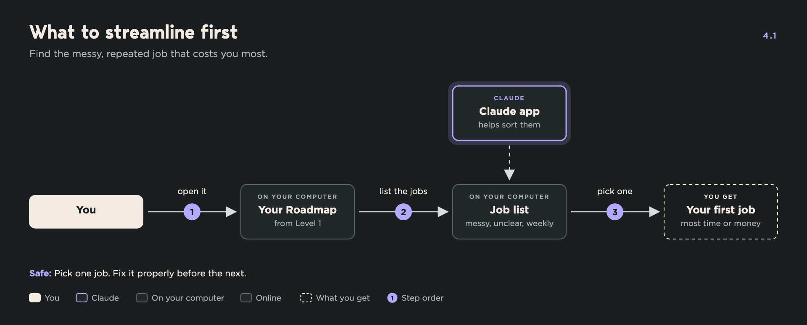
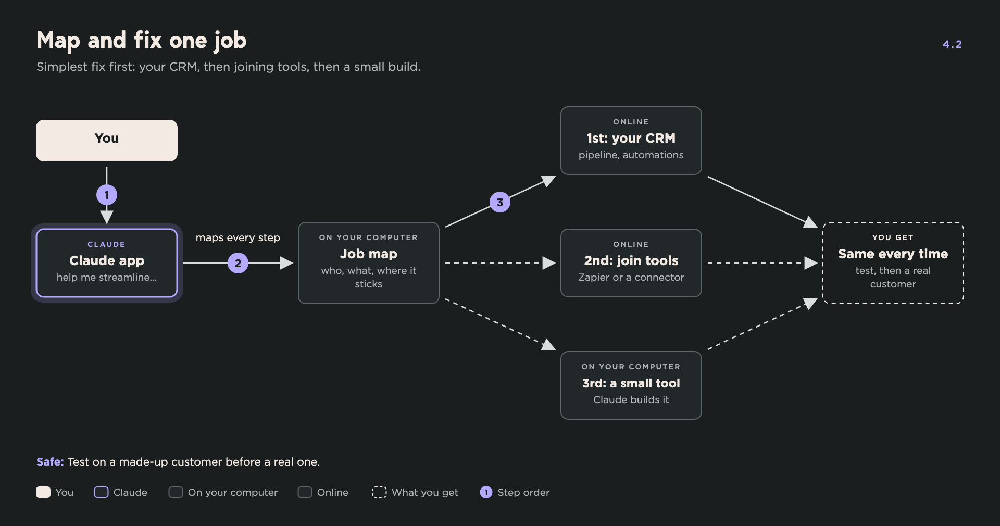
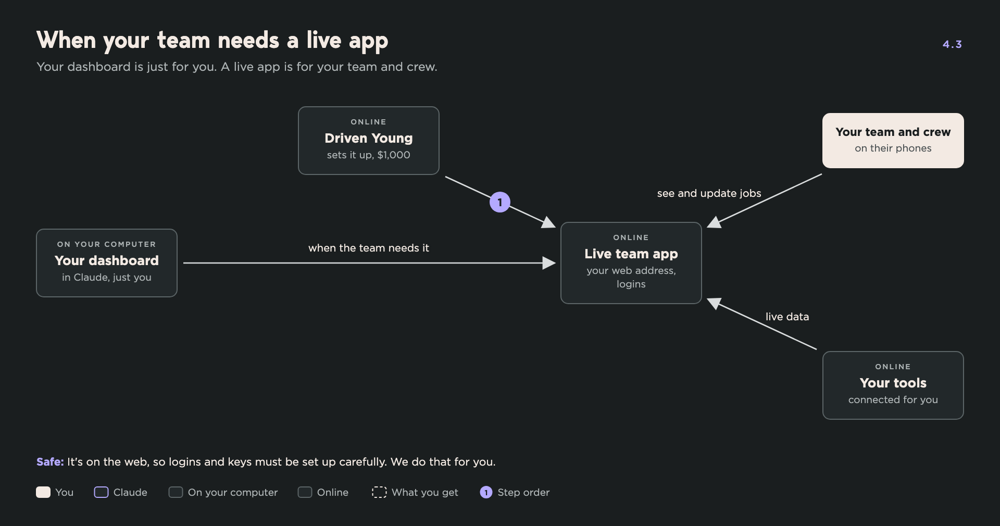

# Level 4 · Streamline

Your messy, repeated jobs turned into a system.

## How it flows
Cream = you. Purple = Claude. Numbers = order.

## 1. Why
Jobs done from memory slip. Build each one once and it runs the same way every time, in the tools you already use.

**Is this safe?**
- Claude shows each change first and only makes what you approve.
- It works in your own tools. Customer details stay in your accounts.
- Nothing goes to customers without you.

## 2. Set up
1. Say **help me streamline my customer onboarding** (or any job: quotes, bookings, job sites, reviews).
2. **Find.** Claude reads your brain (processes and roadmap) and lists messy or repeated jobs, most time saved first.
3. You pick one.
4. **Map.** Claude lists every step: who, what they need to see, where it gets stuck.
5. You check it.
6. **Fix** it the simplest way:
   - **Your CRM can do it:** a pipeline stage per step, automations for reminders, tasks for your team, fields for details (job site, who's on site).
   - **Two tools need joining:** a small automation.
   - **Nothing does it yet:** Claude builds a small tool (quote calculator, job checklist, client page).
7. **Test** it on a made-up customer.
8. Use it for a real one.

**Example (a landscaper):** enquiry → quote → deposit → booked → crew on site → done → follow-up and review. Each step is a CRM stage. Reminders send themselves.

### When your team needs one place for all of it
A **live app for your team**: your own web address, logins for team and crew, your numbers. See `levels/images/dashboard-live-app.png`. Login and keys need care. Driven Young sets it up ($1,000 setup), or do it with Claude (advanced).

## 3. Make your own
1. Streamline a second job, start to finish.
2. Say **add this to my dashboard** to see it working.

## 4. Check
- [ ] One messy or repeated job mapped, step by step
- [ ] Fixed: set up in your CRM, an automation, or a small tool Claude built
- [ ] You (or your team) used it for a real customer or job

Next: Level 5 · Delegate.

---
Driven Young Founder OS · licensed to one business · see LICENSE.md
