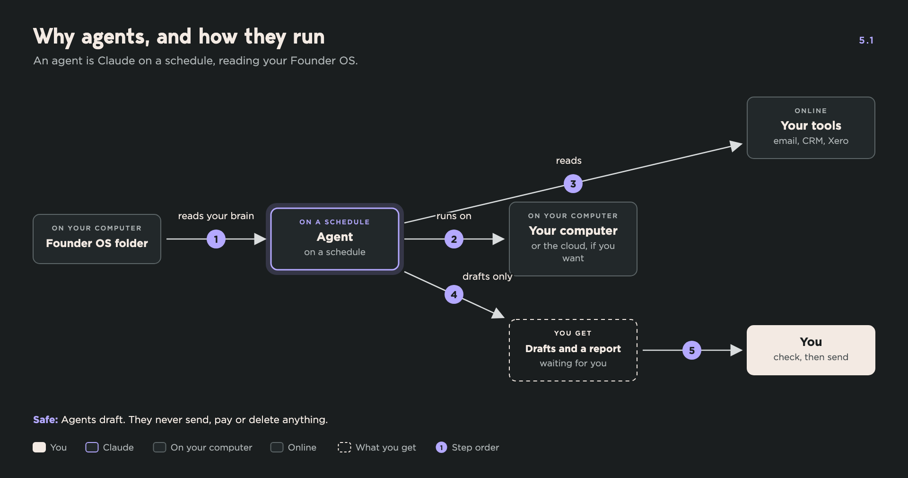
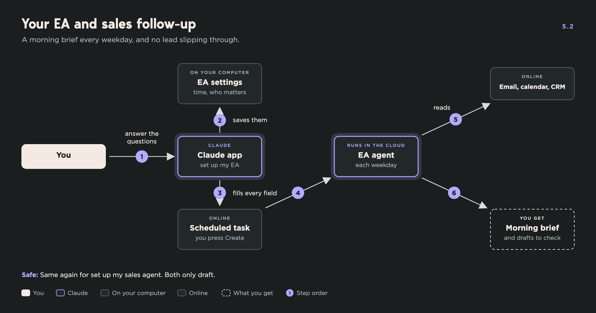
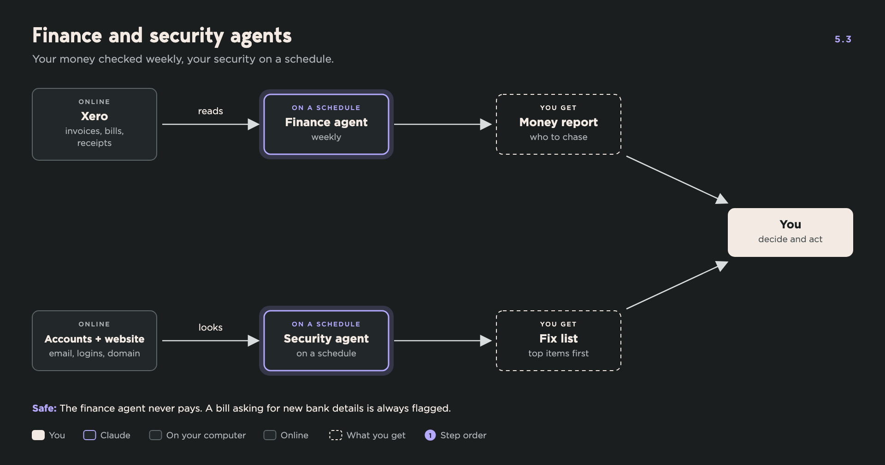
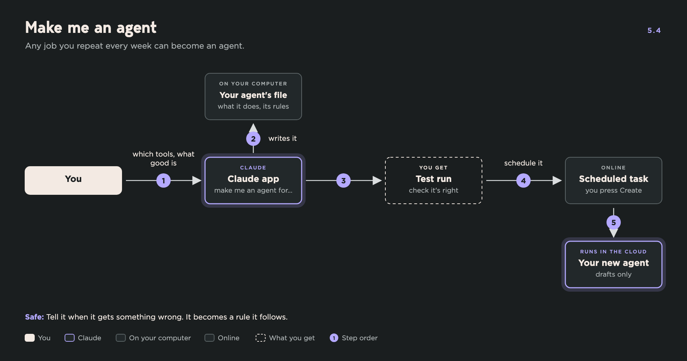

# Level 5 · Delegate

Agents doing the weekly jobs. Drafts only.

## How it flows
Cream = you. Purple = Claude. Numbers = order.

## 1. Why
Inbox, follow-ups, receipts and checks done before you sit down. Agents are Claude scheduled tasks in the cloud, so your laptop can be closed.

**Is this safe?**
- Agents only use the connectors you turned on.
- Agents only draft. They never send, pay, post or delete.
- Each has short rules you can read. Pause any in one click.
- The Security agent checks the rest weekly.

## 2. Set up
Do Level 3 first (the cloud reads your private GitHub copy).

Agents are in the `agents` folder. One at a time, each in a new chat in your Founder OS folder.

| Say | What it does | When |
| --- | --- | --- |
| **set up my EA** | Morning brief of inbox and calendar, replies drafted | Weekday mornings |
| **set up my sales agent** | New enquiries and quiet leads, follow-ups drafted | Daily |
| **set up my finance agent** | Money snapshot, invoices to chase, receipts missing for your bookkeeper | Weekly |
| **set up my security agent** | Your security check on a schedule | Weekly, deeper monthly |

For each agent:
1. Say its phrase.
2. Press **Connect** for any missing tool.
3. Answer a few questions (what time, who matters, where the report goes). Saved in `brain/Agents/`.
4. It runs once so you see a real result.
5. Claude fills in the schedule. You press **Create**.
6. It runs in the cloud, laptop shut. Each run shows in Claude.

Change one: say **change my EA**. Got something wrong? Tell Claude. It adds a rule so the agent learns.

## 3. Make your own
Say **make me an agent for the job I do every Monday.** Claude interviews you, writes it and schedules it, ground rules built in.

## 4. Check
- [ ] EA brief ready each morning (in Claude or your email)
- [ ] At least two agents on a schedule
- [ ] Everything they send waits as a draft

---
Driven Young Founder OS · licensed to one business · see LICENSE.md
