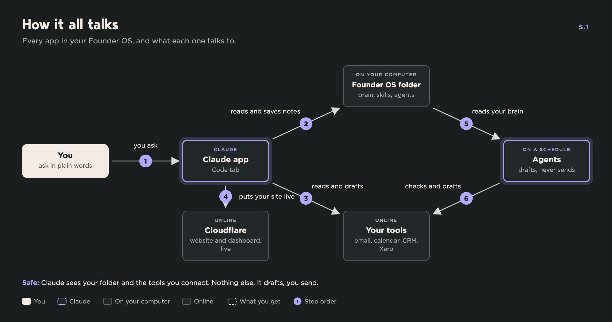
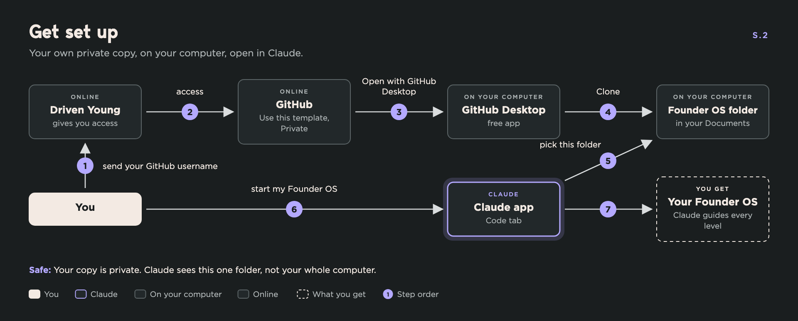

# Before you start: setup checklist

> Driven Young Founder OS. Licensed to one business (see LICENSE.md).

About 30 minutes. Use your work email. Save each password in your password manager.

## How it flows
Cream is you. Purple is Claude.

## Accounts
- [ ] Claude, Pro plan or higher (claude.ai). The free plan can't run the setup.
- [ ] A password manager: 1Password (Mac or Windows), or Apple Passwords on a Mac.

GitHub, Cloudflare and Obsidian come later. Claude sets them up with you.

## On your laptop (Mac easiest, Windows works)
- [ ] Claude desktop app (claude.ai/download), signed in.
- [ ] Node.js, free (nodejs.org/en/download). Click **macOS Installer (.pkg)** or **Windows Installer (.msi)**. Click Next until done.
- [ ] **On Windows only:** Git for Windows, free (git-scm.com, accept the defaults). Claude needs it to work with your files.
- [ ] Updates done, charger packed.

Windows: after Git, close Claude and open it again.

1. In the Claude app, click **Code**. Start a new session.
2. Choose **Documents**. (Windows: if Documents is in OneDrive, choose your user folder.)
3. Paste: *Install my Founder OS from https://github.com/byron-rgb/founder-os and follow its INSTALL.md*
4. When done, start a **new session** in the **Founder OS** folder.
5. Type **start my Founder OS**.

## Your business tools
Check you can log in as owner or admin: email, calendar, accounting (Xero, QuickBooks, MYOB), CRM, and apps you use weekly.

## Bring
- [ ] Price list or menu of services
- [ ] A proposal, quote or brochure you've sent
- [ ] Logo and brand colours, if you have them
- [ ] Your top three goals for the next 12 months
- [ ] Your phone, for sign-in codes

Never share passwords, bank or card numbers or your tax file number. Not even with Claude.
