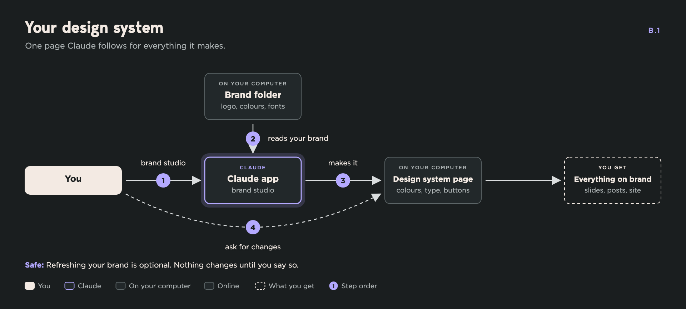
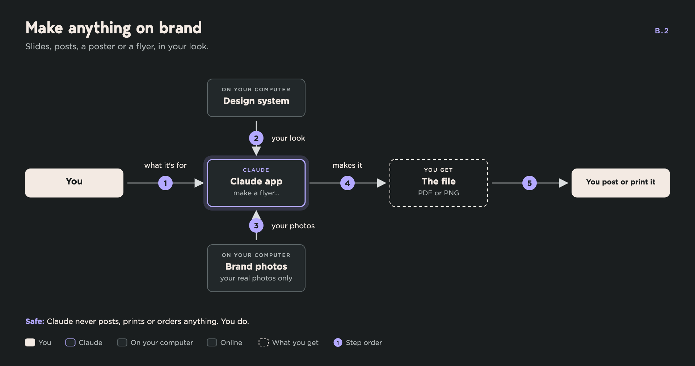

# Brand Studio

Say **brand studio**.

## How it flows
Cream is you. Purple is Claude.

## What you get
1. **Your brand in one place:** logo, colours, fonts and style in `brain/3 Marketing/Brand/` (from Level 1).
2. **A refresh, if you want:** a tidy-up or a step up, side by side. Same logo. You pick.
3. **Your design system:** one file everything follows, plus a page to view it. Also a design system inside Claude, if yours supports it.
4. **The showcase,** on brand:
   - a social post and a story
   - a poster or a flyer
   - a five-slide deck about your main offer
   - one extra: quote cover, email header, business card or price list

## Things to say after
- "Make a poster for <event or offer>"
- "Make this week's posts from these photos"
- "Turn my price list into a one-page flyer"
- "Make slides for my pitch to <client>"

**Is this safe?** It stays in your brand folder. Nothing is posted, printed or sent. Your logo is never redrawn.

---
Driven Young Founder OS · licensed to one business · see LICENSE.md
