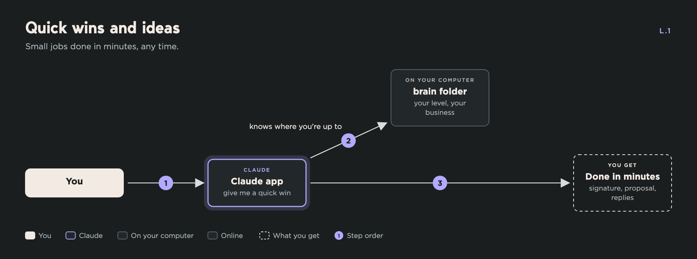

# Quick wins

Small jobs, done in minutes. Say **give me a quick win** and Claude picks one for your level. Or name one.

## How it flows
Cream is you. Purple is Claude.

| Level | Quick win | How Claude does it |
| --- | --- | --- |
| 1 | Email signature | From Profile + Brand Guidelines (no website: leave the link out; no brand colours: black text). Simple HTML table, no hosted images. Save as `.html`, open in the browser, select all, copy, paste into Gmail or Outlook signature settings |
| 1 | Price list PDF | From Offers and Prices. One page, brand colours |
| 1 | Proposal template | Filled from a voice note. From Offers, Customers, Brand Voice. Saved to brain/Work/Proposals |
| 1 | Your FAQ | The 10 questions customers ask. From Customers + Offers. Practical questions only |
| 2 | Quote from a voice note | Voice note or typed notes, prices from the brain, draft only |
| 2 | Meeting to follow-up | Meeting notes or transcript, Brand Voice, saved as a draft |
| 2 | Review replies | Pasted Google reviews, Brand Voice, drafts to copy |
| 2 | Plan my week | Calendar + tasks connectors, Goals. A realistic week |
| 3 | Landing page | One offer, one page, one form, live today. Site starter in site/, design system, `website` skill |
| 3 | Job ad | Hiring page plus the ad. Team + Brand Voice |
| 3 | How-to from a video | Watch skill or a transcript, saved to brain/4 Operations |
| 3 | Client welcome pack | Emails and page for new clients. Processes + Brand Voice, drafts |
| 4 | Invoice reminders | Overdue invoices chased politely. Accounts connector, drafts only |
| 4 | Receipts sorted | Matched for your bookkeeper. Email + accounts connectors |
| 4 | Captions from photos | A week of posts. Photos you drop in, Brand Voice |
| 4 | Contract, explained | Plain English, with what to ask. Not legal advice; flag anything to check with a lawyer |

---
Driven Young Founder OS · licensed to one business · see LICENSE.md
