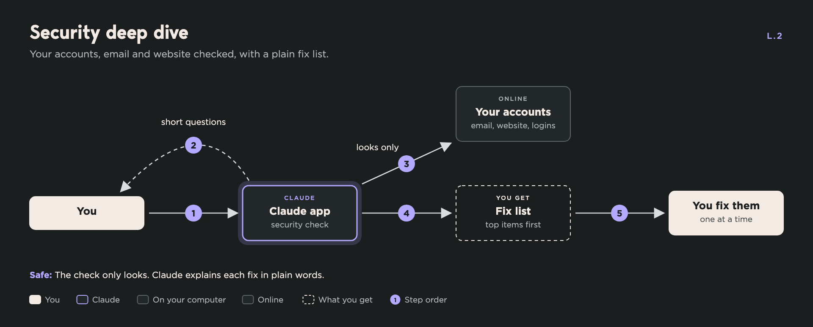

# Security

What's safe, what to watch, how to check.

## How it flows
Cream is you. Purple is Claude.

## Is AI safe for my business?
Yes, set up like this:
- **Claude sees only what you give it:** your folder and the tools you connect.
- **Claude asks first** before it runs or changes anything.
- **Claude never sees your passwords.** You sign in on each tool's own page.
- **Agents draft, you send.** Nothing is emailed, paid, posted or deleted without you.
- **You own everything:** accounts, files, private GitHub.

## Five habits that stop most problems
1. **Two-step login** on email, Claude, GitHub, Cloudflare, CRM and bank.
2. **A password manager** (1Password, or Apple Passwords on a Mac). A different strong password for each account.
3. **No secrets in chats or files.** Never paste a password, card number or key into Claude. If you do, change it.
4. **Install only from the maker's own page.** Never from a link someone sent you.
5. **Unsure? Press No** and ask Claude what it's for.

## Keys and secrets
Most things need no key. Keys are mostly for website forms sending leads to GoHighLevel.
- **Never in the chat.** Copy the key from the tool to your password manager, then to the safe place. Claude says where to click. It never sees the key.
- **Three safe places:** your password manager (master copy), Cloudflare secrets (live site), `site/.env` on your computer (testing only, never saved to GitHub).
- **One key per job**, with only the access it needs.
- **Leaked?** Delete it, make a new one, put it back, run a security check.

Say **help me with a key**.

## Your security check
Say **security check**. About 30 minutes the first time. Claude checks only what fits your tools:
- Fake email sent as you
- Website grade and certificate
- Your email in password leaks
- Two-step login on key accounts
- Who your files are shared with
- Installed AI skills, plugins and connections
- Backups and devices
- Google or Microsoft admin settings
- Your site's code (Level 3)

You get a score out of 100 on Australia's Essential Eight and a fix list in order. Claude only looks. You click every button.

## Every week after
From Level 5 the **Security agent** checks weekly, deeper monthly. You get one line: "2 new, 1 fixed."

## Is this skill, plugin or connector safe?
Before installing, say **is this safe: <link>**. Claude says what it can reach, who made it, and whether to install.

## If something goes wrong
Say **I think I've been hacked**. Change the password, sign out other devices, check recent activity, call your bank if money is involved.

---
Driven Young Founder OS · licensed to one business · see LICENSE.md
